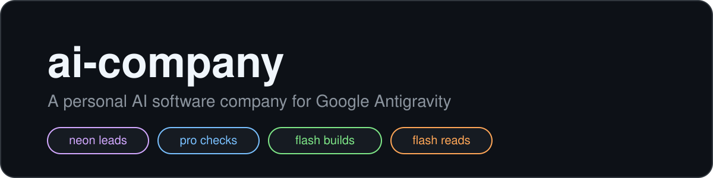
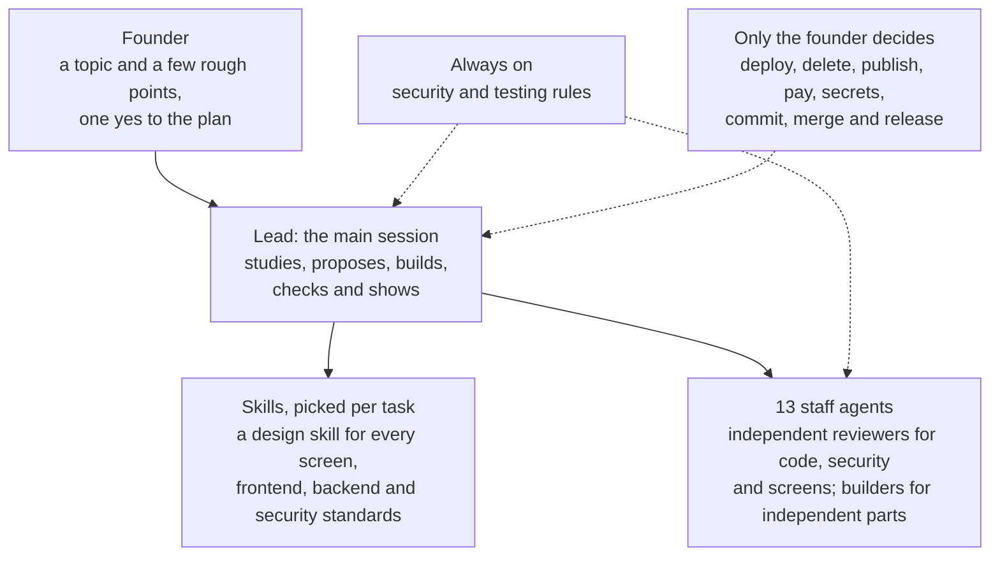
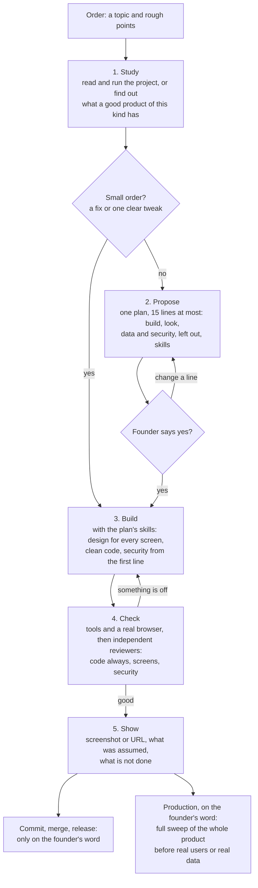
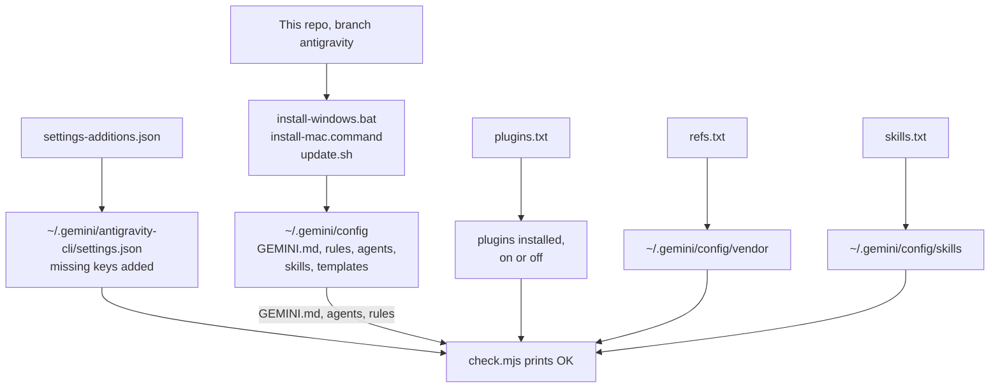

**This is the `antigravity` branch: the same company, for Google Antigravity.** The `main` branch is the original for Claude Code. The two do not share a file on your laptop: this branch installs into `~/.gemini` only and never touches `~/.claude`.

An AI assistant for Google Antigravity, built like a small software company. You are the founder.
You give a topic and a few rough points. It studies the product, shows you one short plan, and after your yes it builds, checks its own work and shows you the result.

## Who it is for

One person who builds software products with Antigravity and wants results to look at, not a process to manage: a solo founder, a freelancer, a small team with one decision maker. It is a working method (a handbook, rules, staff agents and skills), not an app. It is not for teams that need several people to approve a change.

## How it works

## From order to result

The lead also thinks like a business partner. For a new product or a large feature it works out who it is for, what already exists, the simpler way and what it costs to run, and the plan says why the product is worth building and gives plain advice when it would build less or something different. What the company learns across projects goes into one short skill, lessons, read when a project starts. It has two files in `antigravity/skills/lessons/`. `kit.md` holds the lessons that come with the kit: it is in this repo, every laptop has the same one, and `bash update.sh` brings new lessons. `SKILL.md` is yours: `update.sh` creates it once, the company adds your own lessons there, and git ignores it, so your notes never leave your laptop. It lives inside your clone of this repo: keep a copy before you delete or re-clone that folder.

There are two modes. Building (steps 1 to 5) is the default and checks each change: the builder never has the last word, a code-reviewer reads every code change, and new screens and risky changes get their own reviewer. Production is the full sweep of the whole product, run once on the founder's word "production" before real users or real data: every test level, semgrep, the full security checklist, every dependency, every screen and endpoint.

The founder is not interviewed: no rounds of questions. The lead fills the gaps itself from the order, the project and what a good product of that kind has, and puts every choice in the plan. The founder is asked first only for outward or irreversible actions: deploying to production, deleting data or a repo, a force push, making a repo public, messages to real people, a paid service, secrets, and commit, merge and release. Changing the company itself also needs the founder's yes.

## What is in here

| Path | What |
|---|---|
| `antigravity/GEMINI.md` | The handbook every session reads first |
| `antigravity/rules/` | Always-on rules: security, testing and the skill map. Every file here loads into every session, so nothing else goes in |
| `antigravity/agents/` | 13 staff agents |
| `antigravity/skills/` | 8 company skills: new-project, brief-to-spec, backend-standards, frontend-standards, security-checklist, scale-standards (read only when a product needs that scale), product-sense (business thinking for a new product or large feature), lessons (what was learned across all projects; the repo holds the kit's lessons in `kit.md`, your own notes are never committed) |
| `antigravity/templates/` | 5 project templates |
| `antigravity/git-hooks/` | 2 git hooks: commit-msg, pre-commit |
| `plugins.txt` | Every plugin, and whether it is on or off |
| `refs.txt` | 5 reference repos kept in `~/.gemini/config/vendor` |
| `skills.txt` | Skills pulled from their own GitHub repo (`/myoffice`: live view of all agents) |
| `update.sh`, `check.mjs` | Update everything to latest, then verify |
| `antigravity/settings-additions.json`, `settings-merge.mjs` | The kit's settings, and the script that adds the missing ones to `~/.gemini/antigravity-cli/settings.json` |
| `office-proxy.mjs`, `office-remote.cmd` | Private phone access to the office page |
| `docs/STATUS.md` | Project state: done, decisions, benchmark, open issues |
| `CHANGELOG.md` | What changed, one line per change |
| `LICENSE` | MIT: use it, copy it, change it |

## What differs from the Claude Code kit

The handbook, the rules, the skills, the templates and the 13 agents say the same thing as on `main`. What had to change for Antigravity:

- Files live in `~/.gemini/config` (handbook `GEMINI.md`, `rules`, `agents`, `skills`, `templates`, `vendor`), not in `~/.claude`. A project's own file is `GEMINI.md`, not `CLAUDE.md`.
- A rule file starts with `trigger: always_on`; that line is what makes Antigravity load it into every session.
- An agent file names a model class, not one model: `pro` (was opus and fable) or `flash` (was sonnet and haiku). It lists its tools by the names Antigravity documents (`view_file`, `grep_search`, `run_command`, `write_to_file`, `replace_file_content`), and an agent that only reviews gets no tool that changes a file. The command line tool shows the same tools to the model as `read_file`, `run_command`, `write_file` and `edit_file`; the handbook's hard rule uses those names. The Playwright and Sentry connections reach an agent without being listed.
- Plugins are named without a marketplace (`impeccable`, not `impeccable@impeccable`) and are on or off for the whole machine, not per project.
- Left out, because they only exist for Claude Code: the blast-radius plugin, the ccusage status line, the "no attribution" setting, and the two Claude Code how-to repos. taste-skill, the gamedev skills and rea do not install as Antigravity plugins; they are cloned as reference repos and the skill map points to their files.

## What you need

- Antigravity (the `agy` command line tool, 1.5.9 or newer) with a Google account that Antigravity accepts. A paid Google AI plan is needed for the stronger models.
- Windows or Mac.
- The models the company names. The lead runs on Gemini 4 Neon (High), the default model of Antigravity when this was written. Each staff agent names its model class in the `model:` line of its file in `antigravity/agents/`: reviewers and the architect use `pro`, builders and the site monitor use `flash`. If your plan lacks the lead model, `bash update.sh` says so in one WARN line: pick another with `/model`.

The installer changes your machine. Read `install-windows.bat` or `install-mac.command` before you run it. What it does:

- Programs: it installs the Antigravity command line tool if it is missing (its install script is downloaded from `antigravity.google` and run), and Node, Git, GitHub CLI, gitleaks, semgrep, osv-scanner and bun. On Windows also Python. On Mac also Homebrew if it is missing: its install script is downloaded and run.
- `~/.gemini/config`: `rules`, `agents`, `skills` and `templates` become links into this repo. A folder that is already there is renamed to `<name>.backup` first.
- The handbook goes to `~/.gemini/config/GEMINI.md`. On Mac a file that is already there is renamed to `GEMINI.md.backup`. On Windows it is copied to `GEMINI.md.backup` once, and then replaced at install and on every `bash update.sh`.
- Git, for every repo on the machine: the global hooks path is set to `antigravity/git-hooks`, so a repo's own `.git/hooks` no longer run unless that repo sets its own hooks path. This is done only when no hooks path is set: a laptop that also has the Claude Code kit keeps that kit's hooks. Those run gitleaks too, but their `commit-msg` hook removes Claude lines only, so on such a laptop a Gemini or Antigravity attribution line stays in the commit message. The `commit-msg` hook of this branch removes AI co-author and "Generated with" lines (Claude, Gemini, Antigravity) from every commit message; the `pre-commit` hook runs gitleaks. The default branch name becomes `main`, and GitHub CLI becomes git's sign-in helper for GitHub (`gh auth setup-git`). To undo the hooks: `git config --global --unset core.hooksPath`.
- GitHub CLI asks you to sign in (`gh auth login`) if you are not signed in.
- Antigravity: the Playwright MCP server, the Sentry MCP server, every plugin in `plugins.txt`, the 5 reference repos of `refs.txt` in `~/.gemini/config/vendor`, and the myoffice skill from the repo named in `skills.txt`. A plugin written for Claude Code is converted by Antigravity when it is installed. Sentry is a connection to `https://mcp.sentry.dev/mcp` that the site-monitor agent uses; nothing is sent until you sign in with your own Sentry account. If you do not use Sentry, remove it: `agy mcp remove sentry`.
- `~/.gemini/antigravity-cli/settings.json`: at install and on every `bash update.sh`, the keys of `antigravity/settings-additions.json` that your file lacks are added. Today that is one key: the lead model (`Gemini 4 Neon (High)`). A value you set yourself is never changed. A key you delete is added again on the next update: to differ from the kit, set your own value instead of deleting the key. The file as it was before the first change is kept as `settings.json.backup`, unless a file of that name is already there.

## What it costs

You pay through your Google AI plan or a Gemini API key; the kit itself is free. Nothing has been measured on Antigravity yet. On the Claude Code kit (branch `main`, 2026-11-17, small test projects, API prices, one run each) a small task cost $1.21 to $1.93, a task with a new screen $3.78, and a production sweep of a small library $1.86; that table is in `docs/STATUS.md`. Expect other numbers here.

## Install

1. Install Git, then clone this branch into its own folder in your home folder:
   `git clone -b antigravity https://github.com/LeongJinZhou/ai-company ai-company-antigravity` (the repo is public; no sign-in is needed to clone it).
   If you also use the Claude Code kit, keep its clone as it is: the two folders must stay apart, because each kit links its files into its own clone.
   To change the company for yourself, fork it first and clone your fork.
2. Double-click `install-windows.bat` (Windows) or `install-mac.command` (Mac).
3. Restart Antigravity.

The installer prints `OK: ...` when the laptop matches the repo: plugins, reference repos, skills, agents, rules, handbook, settings, the browser connection and the tools, when `agy` can list its models, and when this copy is not behind GitHub. Every laptop that prints `OK` has the same company.

## Update (any laptop, any time)

    bash update.sh

It pulls this branch, then the latest version of every plugin and
reference repo, and checks the result. On Windows run it from Git Bash.
`bash update.sh --check` only checks.

## Plugins

There is 1 core plugin, always on (caveman), and 11 plugins that are off until a task needs them.

A plugin that is `on` in `plugins.txt` loads into every session, so the core
is kept small. The rest are installed but off, so they cost nothing
until needed. Their skill files are still on disk and the lead reads them
when a task matches. `antigravity/rules/skill-map.md` tells the lead which skill
or plugin fits which kind of task, and how to enable one:

    agy plugin enable <plugin>

To change the set everywhere: edit `plugins.txt`, commit, push, run
`bash update.sh` on each laptop.

Plugins run their own hooks and code on your machine. Only add ones you trust.

## Changing the company

In your own fork: edit files and open a pull request against the `antigravity`
branch. It is squash-merged, and `CHANGELOG.md` records each change. Other
laptops get it with `bash update.sh`. `node --test` runs the tests; CI runs
them on every push. This branch is never merged into `main`: the two kits are
kept side by side.

## Watching the agents

Type `/myoffice` in Antigravity. A local page opens at `http://localhost:4545`
showing every session and what it is doing. `/myoffice stop` closes it.

First time in each browser: open **Settings** (gear, top right) and turn on
**Subagents**. They are hidden by default, and without them the workers the lead
sends out never appear. Turn on **Idle** as well to keep finished workers listed.

The page shows your prompts and replies. Start it with `/myoffice --private` before
sharing your screen.

### From your phone (private)

The office answers only on the laptop itself. To open it from your own phone,
without putting it on the public internet, use Tailscale (free):

1. Install Tailscale on the laptop and the phone; sign in to the same account
   on both.
2. On the laptop, once: `"%ProgramFiles%\Tailscale\tailscale.exe" serve --bg --http=80 4546`
3. Run `office-remote.cmd`. To start it at every login, put a file in the
   Windows Startup folder that calls it.
4. On the phone open `http://<laptop-name>.<tailnet>.ts.net/` and bookmark it.
   `tailscale status` on the laptop shows the name.

Only devices on your tailnet can open that link. The
laptop must be on. `office-proxy.mjs` is the small forwarder that makes this
work; it refuses every address that is not a `.ts.net` name. Windows only for
now. Never use `tailscale funnel` for this: that would make the page public.

## Security notes

- This repo is public. It holds the working method only: rules, agents, skills and the installer. Project code stays in its own private repos, and your own lessons file stays on your laptop.
- No secrets, .env files or real data go in this repo. The `pre-commit` hook in `antigravity/git-hooks/` runs gitleaks on staged changes and blocks the commit if it finds a secret. It does nothing if gitleaks is not installed. It needs gitleaks 8.19 or newer; the installers install gitleaks.

## Licence

MIT, see [LICENSE](LICENSE). The plugins, the reference repos and the myoffice skill are fetched from their own repos when you install, and each keeps its own licence.
