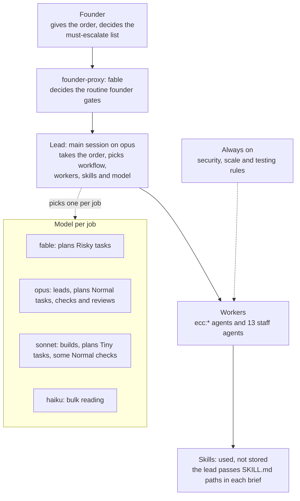
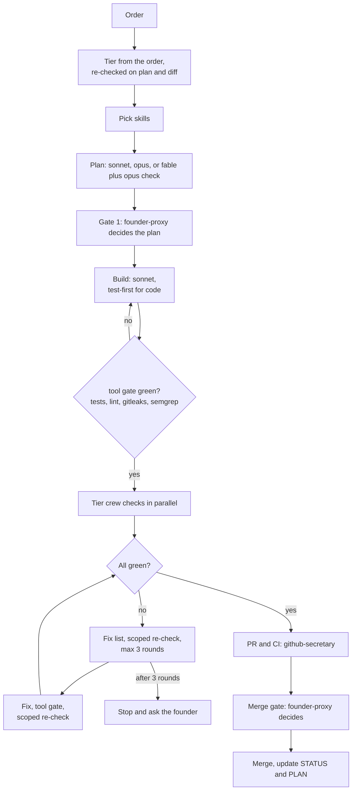
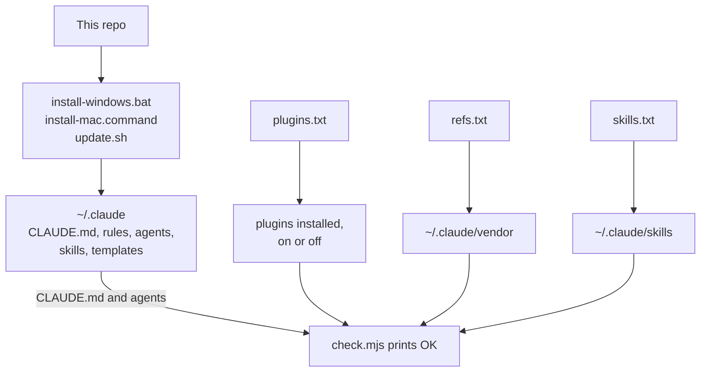

My personal AI software company for Claude Code.
I give the order; a Fable founder-proxy decides the routine gates; the lead session plans and checks the work; staff agents and plugin skills do it.

## How it works

## From order to merge

For each task founder-proxy (a Fable agent) decides the routine gates: the plan and the merge, and patch and minor releases. The founder is told about each decision and is asked only about the must-escalate list (outward or irreversible actions, money, secrets, specs, first production deploys, major versions, changes to instruction files and scripts, known security findings, skipping or weakening a test, check or gate, 3 failed fix rounds, a requirement the spec does not answer, or Fable is not sure).

## What is in here

| Path | What |
|---|---|
| `claude/CLAUDE.md` | The handbook every session reads first |
| `claude/rules/` | Always-on rules: security, scale, testing, skill map |
| `claude/agents/` | 13 staff agents |
| `claude/skills/` | 5 company skills: new-project, brief-to-spec, backend-standards, frontend-standards, security-checklist |
| `claude/templates/` | 5 project templates |
| `claude/git-hooks/` | 2 git hooks: commit-msg, pre-commit |
| `plugins.txt` | Every plugin, and whether it is on or off |
| `refs.txt` | 4 reference repos kept in `~/.claude/vendor` |
| `skills.txt` | Skills pulled from their own GitHub repo (`/myoffice`: live view of all agents) |
| `.claude-plugin/marketplace.json` | This repo as a plugin marketplace (the blast-radius plugin) |
| `update.sh`, `check.mjs` | Update everything to latest, then verify |
| `office-proxy.mjs`, `office-remote.cmd` | Private phone access to the office page |
| `docs/STATUS.md`, `docs/PLAN.md` | Project state and the current plan |
| `CHANGELOG.md` | What changed, one line per change |

## New laptop

1. Install Git, then clone this repo into your home folder:
   `git clone https://github.com/LeongJinZhou/ai-company` (sign in when asked; the repo is private).
2. Double-click `install-windows.bat` (Windows) or `install-mac.command` (Mac).
3. Merge `claude/settings-additions.json` into `~/.claude/settings.json`. The file sets the lead model (`opus`), turns ECC GateGuard off, clears commit and PR attribution, and sets the ccusage status line. GateGuard is ECC's check-before-edit gate; the blast-radius plugin is the preview for risky shell commands.
4. Restart Claude Code.

The installer prints `OK: ...` when the laptop matches `plugins.txt`.

## Update (any laptop, any time)

    bash update.sh

It pulls this repo, then the latest version of every marketplace, plugin and
reference repo, and checks the result. On Windows run it from Git Bash.
`bash update.sh --check` only checks.

## Plugins

There are 5 core plugins, always on, and 11 plugins that are off until a task needs them; one more marketplace is added for on-demand installs.

Core plugins (`on` in `plugins.txt`) load in every session. The rest are
installed but off, so they cost nothing until needed. `claude/rules/skill-map.md`
tells the lead which one to enable for which kind of task:

    claude plugin enable <plugin@marketplace> --scope project

To change the set everywhere: edit `plugins.txt`, commit, push, run
`bash update.sh` on each laptop.

Plugins run their own hooks and code on your machine. Only add ones you trust.

## Changing the company

Edit files here and open a pull request. It is squash-merged, and
`CHANGELOG.md` records each change. Other laptops get it with `bash update.sh`.
`node --test` runs the tests; CI runs them on every push.

## Watching the agents

Type `/myoffice` in Claude Code. A local page opens at `http://localhost:4545`
showing every session and what it is doing. `/myoffice stop` closes it.

First time in each browser: open **Settings** (gear, top right) and turn on
**Subagents**. They are hidden by default, and without them the workers ECC
sends out never appear. Turn on **Idle** as well to keep finished workers listed.

The page shows your prompts and replies. Start it with `/myoffice --private` before
sharing your screen.

### From your phone (private)

The office answers only on the laptop itself. To open it from your own phone,
without putting it on the public internet, use Tailscale (free):

1. Install Tailscale on the laptop and the phone; sign in to the same account
   on both.
2. On the laptop, once: `"%ProgramFiles%\Tailscale\tailscale.exe" serve --bg --http=80 4546`
3. Run `office-remote.cmd`. To start it at every login, put a file in the
   Windows Startup folder that calls it.
4. On the phone open `http://<laptop-name>.<tailnet>.ts.net/` and bookmark it.
   `tailscale status` on the laptop shows the name.

Only devices on your tailnet can open that link. The
laptop must be on. `office-proxy.mjs` is the small forwarder that makes this
work; it refuses every address that is not a `.ts.net` name. Windows only for
now. Never use `tailscale funnel` for this: that would make the page public.

## Security notes

- This repo is private.
- No secrets, .env files or real data go in this repo. The `pre-commit` hook in `claude/git-hooks/` runs gitleaks on staged changes and blocks the commit if it finds a secret. It does nothing if gitleaks is not installed. It needs gitleaks 8.19 or newer; the installers install gitleaks.
